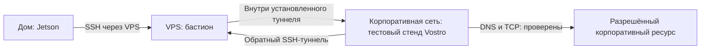

# Habr Part 2 article plan (2026-09, ред. 2) / План статьи Habr — Часть 2 (редакция 2)

> 🇬🇧 **Status:** writing plan, restructured 2026-09-26 around a new spine (see §3).
> 🇷🇺 **Статус:** план к написанию, переформирован 2026-09-26 вокруг новой оси (см. §3).
>
> 🇬🇧 Part 1 → https://habr.com/ru/articles/1062914/ (13K, +6, 9 comments, none after 2026-07-30).
> 🇷🇺 Часть 1 → тот же URL.
>
> 🇬🇧 Fact canon: `DEVELOPMENT_PLAN_2026-09_SBER_ERA.md`, ADR-0007/8/9/12, checkpoints 09-19…09-22, `CLAUDE.md`.
> 🇷🇺 Канон фактов: те же файлы.
>
> 🇬🇧 Do **not** center Part 2 on "ML on Vostro" — Vostro is **out** of NAS architecture.
> 🇷🇺 **Не** делать сюжет «ML на Vostro» каноном.
>
> 🇬🇧 **What changed in this revision:** the previous version (§ below, kept for history in git blame)
> was organised as a feature tour — gateway, two Gigas, backups, roadmap. This revision drops that
> shape. The owner's instruction was explicit: the project's strong side is retracted diagnoses and
> honest pitfalls, not a checklist of what got shipped. The new spine is one recurring defect, found
> six separate times across three months, and what it cost each time.
> 🇷🇺 **Что изменено в этой редакции:** прежняя версия была устроена как обзор фич — шлюз, два GigaChat,
> бэкапы, roadmap. Эта редакция уходит от такой формы. Указание владельца было прямым: сильная сторона
> проекта — отозванные диагнозы и честные грабли, а не список поставленного. Новая ось — один и тот же
> повторяющийся дефект, найденный шесть раз за три месяца, и его цена каждый раз.

## Обновление очереди — 2026-10-09

### Завершение доказательной базы перед написанием — 2026-10-10

Не требуется закрыть весь roadmap, чтобы начать статью. Для каждого выбранного
эпизода нужны воспроизводимые факты и точные границы проверки.

| Приоритет | Что завершить | Критерий готовности | Если не завершено |
|---|---|---|---|
| 1 | ✅ Живой E3 и выкат DP-2/DEP-1, 2026-10-10 | Jetson ARM64, UID10001, API200/restart503/proxy403; владелец подтвердил Telegram-ответ. Stat-only снимок показывает свежие дампы; systemd остаётся unknown. Откат подготовлен, не исполнен. [Доказательства](HABR_PART2_MATERIALS.md) | Наличие/возраст дампов не доказывают полное DR; повторный Telegram-ответ после исправления метаданных ещё не подтверждён |
| 2 | ✅ Проверить эпизод ds-worker из Spektr, 2026-10-10 | Первичный JSON: 46/45 ходов, **18**, а не 17 отказов; классификатор 37 passed, runner 11 passed. Новый CLI-прогон success без отказов, валидный отчёт принят ведущим Spektr. Шесть учтённых попыток $0.280097. [Первичные факты и границы](HABR_PART2_MATERIALS.md) | Не обобщать на все будущие команды; закрытые прикладные тесты и Linux-прогон на Vostro NAS не повторял |
| 3 | Подготовить доказательства сети и облачного восстановления | Сохранить обезличенные схемы/выводы; подтвердить SHA и длительность последнего успешного CI; показать хеши/права четырёх файлов Cloud.ru и границы эксперимента | Ссылаться только на уже доказанные запуск #263 и тест четырёх конфигураций |
| 4 | Уточнить Cloud.ru SKU и фактическое списание | Данные кабинета/биллинга подтверждают проект, услугу, грант или рублёвый расход | Не заявлять, что опыт оплачен грантом; подтверждение владельца о балансе выделить отдельно |
| 5 | Подготовить материалы для автора | Для шести случаев: дата, источник, ошибочное объяснение, проверка, исправление; 5–7 обезличенных иллюстраций; суммы с границами учёта; ссылка на ООО «РИПАС СПБ»; финальная проверка текста/скринов на закрытые данные | Удалить неподтверждённый тезис, а не заменять доказательство предположением |

**Усиление, не обязательный барьер для начала текста:** общий синтетический
эксперимент NAS/Spektr «ноль / неисправность / нет данных»; полный DR на
изолированном стенде с импортом обеих БД, данными, приложениями, автозапуском
и измеренными RPO/RTO. Пока стенд не выбран, полное восстановление не заявлять.
Рабочий NAS не останавливать ради доказательства. Vostro нельзя считать свободным
стендом для DR без проверки ресурсов и согласования его контракта.

Дополнение экономики агентов, выполнено 2026-10-10: Decisions API на 25
размеченных вымышленных задачах дал 25/25 правильных категорий; все пять
неоднозначных задач передаются ведущему. Пять пакетных запросов стоили $0,
подготовка набора DeepSeek — $0,017529. Это небольшой тест рекомендаций,
не доказательство общей точности и не автоматическая выдача прав.
[Метод и первичные результаты](HABR_PART2_MATERIALS.md).

**Уже есть:** CI #263 и #264 (коммит `922161d`, success, 1 мин 30 с;
результат #264 проверен по API 10 октября), восстановление четырёх конфигураций Cloud.ru (хеши и
права 4/4), локальные SEC-2/DEP-1 и тесты DP-2/E3, полный транспортный путь
Jetson→VPS→Vostro→корпоративный SSH-порт, атрибуция предприятия. Авто-восстановление
сети после обрыва и reboot не проверено; это потребуется только при включении
соответствующего утверждения в статью. Возвращать Mac в NAS не требуется.

### Дом → корпоративный ресурс: проверенный эпизод 2026-10-10

Уточнение владельца: **Vostro — стенд для различных тестовых решений**,
расположенный в корпоративной сети, а не рабочий компьютер пользователя.
На нём действуют службы соседнего проекта; тестовый статус не разрешает их
произвольно отключать. В подписи схемы использовать «Корпоративная сеть:
тестовый стенд Vostro».

Владелец предложил включить практическую связь Jetson и Vostro с корпоративной
средой. Цепочка проверена 2026-10-10: с Jetson выполнен SSH-вход на Vostro через
VPS, оттуда разрешено имя корпоративного сервера и установлено TCP-соединение
с его SSH-портом. Это проверка транспорта, не корпоративной авторизации,
доступа к репозиторию или работы прикладного сервиса. Боевые данные не читались.

Место в статье — существующий случай сетевой доступности: основной адрес VPS
не отвечает с Jetson, резервный работает; доступ проверяем с исходного узла,
а не только с компьютера, где включён VPN. Добавленный proxy выбирает адрес
по ограниченной TCP-пробе и сохраняет проверку известного ключа сервера.
TCP-доступность ещё не доказывает SSH handshake; установленную сессию proxy
не переносит на другой адрес. Восстановление после искусственного обрыва
и после перезагрузки в этом эпизоде не проверено.

В статье только условные имена узлов: реальные адреса, порты, ключи, правила
корпоративного доступа и результаты чтения рабочих данных не публикуются.
Ссылка на ООО «РИПАС СПБ» обозначает контекст рабочего проекта, а не разрешение
читателям подключаться к корпоративной сети. NAS не становится инфраструктурой
боевой АСУДД. Из этого эпизода не следует полноценная изоляция семейных сервисов
от корпоративных ресурсов или минимальность прав используемого VPS-аккаунта.

### Соседний проект: совместный эпизод — кандидат от 2026-10-10

По поручению владельца отправлен запрос `nas → work`, доска `m0289` (исправляет
кодировку первоначального `m0288`): назначение,
безопасное описание архитектуры, проверенные применения Сбер-стека, совместные
результаты, инциденты, стоимость и допустимый состав публикации. Получена часть
**spectr/atc — m0291**, безопасная выжимка
`E:/agent_coordination/shared/atc/SPECTR_FOR_NAS_HABR_2026-10-10.md`.
Ответ work по его собственному проекту ещё ожидается; m0291 его не заменяет.
Доступ к материалам проекта не означает разрешение их публиковать.

**Согласование владельца от 2026-10-10:** обобщённые материалы Spektr можно
использовать в статье с указанием предприятия **[ООО «РИПАС СПБ»](https://ripas.ru/)**.
Название и сайт предоставлены владельцем; сайт проверен 2026-10-10, название
совпадает с реквизитами на странице. Рабочая атрибуция для эпизода:
«Тот же подход к независимой проверке мы применяем в моём рабочем проекте
Spektr в ООО „РИПАС СПБ“» (название компании — ссылка).
Это согласование обобщённого эпизода и атрибуции, без публикации закрытых
исходников, протоколов, конфигураций и реальных журналов объектов.

**После ответа atc предпочтительный общий эпизод — ошибочный диагноз самого
исполнителя DeepSeek.** По выжимке, ds-worker сообщил «неизвестная модель»,
но итоговая запись CLI показывала превышение лимита ходов (46 при лимите 45),
в том числе, по первоначальному сообщению, 17 отклонённых команд.
**Независимая проверка NAS 2026-10-10 уточнила число: 18.** Настоящий JSON
подтверждает лимит ходов; исправленный классификатор возвращает эту причину,
37 его тестов прошли. Команды проверки добавлены в конфиг разрешений CLI;
новый прогон завершился успешно без отказов команд и с валидным отчётом.
Другой новый прогон завершился success, но нарушил контракт `test_results`:
успех CLI не означает принятого результата. Встроить эпизод в существующий блок экономики
агентов, без добавления седьмого большого сюжета.

Стоимость четырёх прежних попыток независимо сверена: **$0.215531**;
с двумя новыми — **$0.280097 за шесть учтённых попыток**. Ранние задачи
без учёта и работа ведущих моделей сюда не входят.
Не сравнивать эту сумму напрямую с $0.315716 NAS:
состав работ и границы учёта различаются. Общими являются инструмент/правила
делегирования и карты доступа, а не единая прикладная система. GigaChat,
Cloud.ru и GitVerse в spectr **не применялись**; не приписывать ему использование
Сбер-стека на основании выданного доступа.

Эксперимент atc конкретизировал: 96 интервалов по 15 минут, три синтетических
детектора — исправный с законными ночными нулями, залипший, с пропусками.
Рекомендуемая приёмка: ноль не равен null; ровная серия лишь признак подозрения,
без эталонных данных и контекста она не доказывает физическую неисправность.
Для связи с NAS показать ту же семантику в E3: отсутствующий источник не даёт
зелёного статуса. Реализация и совместный прогон пока не выполнены.

Для части work ранее предложено расширить случай **d: ошибка биллинга Cloud.ru**.
Соседний проект участвовал в независимой проверке формулы и единиц измерения
(`m0144`, `m0145`, 2026-09-21). Показать цепочку «первое объяснение → возражение
соседа → проверка → отзыв диагноза → регрессионный тест». Для расчёта достаточно
синтетического примера; реальные строки биллинга не публиковать без согласования.
Вывод о единицах хранения в m0144 — гипотеза по измерениям с указанными ограничениями,
а не доказательство действующих тарифов или правил гранта.

Второй кандидат — переносимость инженерных правил между семейным NAS и рабочим
проектом: отсутствие данных не означает успех, классы данных определяют допустимого
исполнителя, результат DeepSeek требует независимой приёмки. Общую реализацию или
работающую интеграцию заявлять только после ответа work и проверки источников.

Возможный эксперимент, **пока предложение**: одинаковые публичные/синтетические
сценарии «исправно / неисправно / нет данных» в обоих проектах; сравнить отчёты,
ошибки исполнителя, проверки и стоимость. До выполнения не заявлять результат.
Реальные данные объектов, закрытые протоколы и исходники работодателя не использовать.

Редакционный предел: один совместный эпизод в основном тексте, ссылка на сайт
ООО «РИПАС СПБ» при первом упоминании. Новые схемы, код и скриншоты за пределами
обобщённой выжимки проверять отдельно. Сохранить исходную ось из шести случаев.

**Четыре блока сверены в [журнале материалов](HABR_PART2_MATERIALS.md):** GitVerse
run 263 — success за 3 мин 50 с; Cloud.ru — четыре конфигурации, хеши и права 4/4;
E3 — проблемы отделены от неизвестных сигналов в коде и CI; DeepSeek — цены
конкретных попыток с ошибками и независимой приёмкой. Эти доказательства дополняют
существующую сюжетную ось. Живой ответ E3 подтверждён 2026-10-10; полное DR остаётся открытым.
Проверка восстановления в домашней сети перенесена владельцем на 2026-10-10.

Сохраняем исходную сюжетную ось из **шести случаев**: новые факты добавляются как кандидаты и не увеличивают витрину автоматически. Проверить, можно ли встроить в статью: OOM/hook/repository-hygiene случаи и их исправления (сначала связать каждый с доказательством); подготовку GitVerse CI; состояние E3 — сбор health-фактов и owner-only отчёт, а также неизвестные сигналы и наличие необязательного объяснения GigaChat. Граница E3 неизменна: никаких действий, инициированных LLM. Для каждой темы нужны дата, доказательство и чёткий статус «сделано / подготовка / план» в журнале материалов.

Cloud.ru grant снова активен по подтверждению владельца от 2026-10-09: 4 000 бонусов до 6 ноября. Это не независимая проверка кабинета; проект/SKU нужно проверить калькулятором до создания ресурсов. Официальные условия исключают Foundation Models, Container Apps, GPU/ML Inference и Marketplace ([условия гранта](https://cloud.ru/docs/billing/ug/topics/concepts__start_grant)). Предложение, не разрешение на расход: backup/restore минимального зашифрованного набора конфигурации в Object Storage с потолком 500 бонусов и резервом 3 500; вторичный вариант — изолированная CPU-only VM для watchdog после проверки калькулятора. Это не production off-site семейных данных. Автоматический платный fallback и пополнение рублями не разрешены. В статью сведения о гранте попадут только с точным статусом проверки.

Финальный текст статьи пишет владелец с учётом правил конкурса по использованию ИИ; этот документ задаёт редакционную очередь и проверяемые факты, а не готовый текст для публикации.

---

## 1. Зачем вторая часть

Часть 1 = **как поднять** домашнее облако на старом Nano + USB-драма + CGNAT.
Часть 2 = **как жить дальше**, когда:

- семья уже пользуется (Talk-бот, фото, Telegram-бот, качалка, VPN);
- читатели спросили про ML / GPU / «зачем Jetson»;
- пришлось **пересобрать модель узлов** (не 4 машины, а SoR + edge);
- подключилась **РФ-экосистема Сбера** (GigaChat + Cloud.ru) без выноса фото в облако «как в Google»;
- за три месяца эксплуатации накопилось **шесть отдельных случаев**, когда «зелёная галочка» (healthy-контейнер,
  «восстановлено», «заблокировано», формула в биллинге) оказывалась неправдой — и один и тот же механизм
  ошибки повторялся снова и снова.

**Обещание читателю:** это не отчёт «поставил ещё сервисы». Это разбор одного и того же способа
обманываться — и того, что каждый раз оставалось после разбора: тест, правило или алерт, который
ловит именно этот класс ошибки в следующий раз.

---

## 2. Рабочий заголовок (варианты)

1. **«Домашнее облако на Jetson Nano, часть 2: почему "работает" — самое опасное слово в мониторинге»**
2. «Три месяца после Habr: как я шесть раз объяснял симптом раньше, чем проверял входные данные»
3. «Zdorovый контейнер, немой бот: что не показывает healthcheck»

Рекомендация: **вариант 1** — конкретен, не кричит «список фич», сразу задаёт угол читателю, который
после части 1 ждёт продолжения, а не рекламы Сбера.

Хабы: DIY, sys_admin, artificial_intelligence (осторожно), hardware / antikvariat.

---

## 3. Угол и тезис

**Тезис:**
> За три месяца эксплуатации один и тот же дефект нашёлся шесть раз в шести разных системах:
> **объяснение появлялось раньше, чем была проверена входная величина**, а «работает» на экране
> (healthy-контейнер, «восстановлено из бэкапа», «сеть заблокирована», формула в биллинге) оказывалось
> состоянием интерфейса, а не состоянием системы. Три месяца ушли не столько на новые сервисы, сколько
> на то, чтобы перестать доверять зелёным галочкам и научиться проверять независимым, более дешёвым
> сигналом — сначала на себе, а с 26 сентября и на новом инструменте (дешёвый LLM-исполнитель), который
> тут же поймал ровно тот же класс ошибки.

**Почему эта ось, а не список фич (обоснование):** читатель части 1 уже видел, что Jetson поднимается
и держит семью; вопрос части 2 — не «что ещё поставили», а «что ломалось, пока это работало, и как я
об этом узнавал». Список поставленных сервисов (GigaChat, Cloud.ru, Telegram-бот, качалка) — это фон,
на котором проявляется один и тот же механизм: цикл опроса умирает молча, а процесс жив; бэкап
восстановлен, но не с той машины, которой это будет нужно; сеть заблокирована зеркально тому, как год
назад; формула в биллинге умножает не то. Owner прямо просил не превращать статью в перечень галочек —
и сквозная ось «одна и та же ошибка, шесть раз, каждый раз чуть дешевле её ловить» — единственная,
которая держит весь материал вместе без пересказа changelog.

**Антитезис читателя (закрыть в тексте):**
«Просто поставь Zabbix / полноценный мониторинг» — не помогает: во всех шести случаях мониторинг
показывал ровно то, что был должен показывать (контейнер жив, процесс не упал, порт слушает) —
проблема была не в отсутствии метрики, а в том, что метрика измеряла не тот уровень.

---

## 4. Структура статьи (≈14–20 мин чтения)

| § | Блок | Тезис раздела | Доказательства из журнала |
|---|---|---|---|
| 0 | Лид | 3 месяца после части 1: что изменилось (семья пользуется, GigaChat/Cloud.ru подключены), и почему эта статья не про фичи | Part 1 метрики; таблица версий/этапов A–C из `CHECKPOINT_2026-09-19.md` — одной строкой, не разделом |
| 1 | Слом 4-узловой мечты | Планировали 4 узла, осталось SoR (Jetson) + edge; GPU так и не пригодился — отвечает на «зачем Jetson»/GPU-вопросы части 1 мимоходом, не отдельным FAQ | ADR-0007; `docs/audit/2026-09-19_full_audit/`; баланс GigaChat из `CHECKPOINT_2026-09-19.md` |
| 2 | Один дефект, шесть находок — витрина | Центральный раздел. Каждая находка — по формуле «что показывало зелёным → что оказалось на самом деле → чем поймано → что теперь стоит на этом месте» | см. таблицу §4.1 ниже |
| 3 | Зеркальная блокировка (26.09) | Через месяц после того, как научились чинить блокировку IP VPS, тот же провайдер заблокировал уже новый IP — и старый снова стал рабочим; неделю не было ни доступа, ни алертов, ни отчёта, потому что канал, который должен был сообщить о проблеме, сам был частью проблемы | правило №17 CLAUDE.md; факт 2026-09-26 в `HABR_PART2_MATERIALS.md` |
| 4 | Экономика агентов повзрослела | Второй исполнитель (DeepSeek) добавлен в конвейер — и в первом же пробном цикле его результат поймали на нарушении контракта тем же способом: не поверили на слово, проверили командой | ADR-0012; `docs/handoff/DEEPSEEK_WORKER.md`, пробный цикл 26.09 (≈$0.048) |
| 5 | Что теперь стоит на месте каждой находки | Не сама находка ценна, а тест/правило/алерт, оставшийся после неё — quality gate №14, «тишина ≠ успех», супервизор циклов Telegram, восстановление проверяется с той машины, которая будет восстанавливать | `docs/32_QUALITY_GATE.md`; коммит `db458f7`; правило CLAUDE.md о независимой проверке |
| 6 | Что по-прежнему сломано и я это знаю | Offsite S3 фото пуст (решение владельца), restic 400 с устройства не разгадан, `usefact` для Object Storage не проверен, EOL Ubuntu 18.04, coturn не развёрнут | `CHECKPOINT_2026-09-21.md`, `CHECKPOINT_2026-09-22.md` §restic S3 400 |
| 7 | Коротко: что дальше (Part 3?) | S3 L2, голосовые сообщения (Vosk), возможный Part 3 | план §2.2, `docs/superpowers/specs/2026-09-20-voice-messages-design.md` |
| 8 | CTA | GitHub, GitVerse, Part 1 | ссылки |

Объём: **9–13k знаков** основного текста + 5–7 схем/скринов. Раздел §2 — самый длинный, ожидаемо
40–50 % текста.

### 4.1 Витрина находок (материал для §2, в порядке силы, не хронологии)

| # | Что показывало «зелёным» | Что было на самом деле | Чем поймано | Что теперь на этом месте |
|---|---|---|---|---|
| a | Nextcloud отвечал 400 клиентам, выглядело как старый баг «бот 12 дней бил в стену» | Диагноз оказался собственной регрессией того же дня: сняли `overwritehost`, включив проверку доверенного домена, и сломали внутренний вызов по docker-имени | Базовая линия ДО правки: 13 626 опросов, все `304`, ноль `400`; все 7975 отказов легли в один час — час правки | Правило CLAUDE.md: «увидел аномалию — сначала посмотри тот же показатель ДО своей правки» |
| b | Container `homecloud_nasa_api` healthy, бот в Telegram молчал 6 суток (20–26.09) | `socksio.ProtocolError` не наследует `httpx.HTTPError`, цикл опроса умирал молча; процесс и healthcheck жили дальше | Найдено при разборе тишины бота, не мониторингом | Супервизор циклов (`db458f7`): перезапуск упавшего/зависшего (нет пульса 300 с) цикла, статус вынесен в `/healthcheck` |
| c | «Восстановление офсайт-копии фото проверено, 20/20 sha256» | Проверка шла не с той машины, которая столкнётся с реальным восстановлением: с Jetson тот же `restic` бьётся в `400 Bad Request`, при этом прямой S3 тем же ключом работает без единого отказа | Попытка снять репозиторий перед плановым удалением копии | Правило: восстановление проверять **с той машины, которая будет восстанавливать**, а не с той, где удобнее отлаживать |
| d | Формула расходов Cloud.ru «починена» — попала в `main` | Деньги на счету умножили на ставку второй раз (`amount × cost`); верно — просто сумма `amount`. Ошибку нашёл сосед по площадке, через час отозвал и свою поправку тоже | Признак лежал перед глазами весь день: `amount / usefact` у токенов = ровно ставке — не был использован | 12 тестов, включая проверку самих данных (`amount == usefact × cost`), чтобы будущая выгрузка ломала тест, а не подгонялась под код |
| e | Обратный туннель Jetson↔VPS «просто лёг» — выглядело как новая, непонятная поломка | Зеркало инцидента годичной давности: домашний провайдер заблокировал уже **новый** IP VPS, а старый (заблокированный тогда) снова пропускает трафик; тот же сервер — совпал ключ хоста | Сверка SSH host key старого и нового адреса | `VPS_HOST` переключён на старый адрес; правило №17 — прямой ssh из дома как путь восстановления, не зависящий ни от туннеля, ни от VPS |
| f | Пять закачек в качалке «зависли», страж молчал | aria2 у торрента на паузе отдаёт `totalLength=0`, хотя длины файлов давно известны — код ждал размера, который не придёт | Найдено при разборе конкретной жалобы, не алертом | `total_size()` считает по сумме длин файлов, а не по полю ответа aria2 |

Шесть строк — это витрина, не весь список: полный перечень отозванных диагнозов длиннее (см.
раздел «Грабли» в `CLAUDE.md`), в статью идут самые показательные и разноплановые (мониторинг,
бэкап, сеть, биллинг, встроенный сторож).

---

### Дополнение к случаю мониторинга: свежие дампы БД, которых API не видел

Решение владельца 2026-10-10: включить новые результаты по БД.
Встроить в существующий сюжет о различии неисправности и отсутствия данных,
связав с границами проверки бэкапа; не добавлять отдельный седьмой случай.

Последовательность: Telegram-ответ получен → API не видит каталог дампов →
на Jetson найдены свежие копии → добавлен stat-only снимок без доступа API
к содержимому БД → проверено автоматическое обновление снимка.

В наблюдении 2026-10-10 13:41 МСК: Nextcloud 2,6 МБ и Immich 19,1 МБ,
возраст обоих 7 часов; на хосте 14 файлов дампов. Сбор каждые 5 минут,
снимок старше 15 минут означает unknown. Показать обезличенный фрагмент
живого отчёта с метаданными и отдельным unknown для systemd.
Эти цифры относятся к конкретной проверке, а не к постоянному размеру БД.

Граница вывода: наличие и возраст дампов проверены; целостность SQL,
восстановление БД и полное аварийное восстановление этим не доказаны.
Текст, таблица фактов и источники — в
[материалах статьи](HABR_PART2_MATERIALS.md#дампы-бд-отсутствие-наблюдения-не-означает-отсутствие-бэкапа--2026-10-10).

## 5. Скриншоты / визуал (чеклист съёмки)

| # | Кадр | Где снять | Статус |
|---|---|---|---|
| 1 | Схема узлов Part1 vs Part2 (SoR + edge, без 4 машин) | draw.io / excalidraw | todo |
| 2 | `docker ps` / healthy-контейнер рядом с журналом «бот молчал 6 суток» — контраст | Jetson SSH + текст рядом | todo (редact) |
| 3 | `/healthcheck` с новым полем статуса Telegram-цикла (после `db458f7`) | Jetson SSH | todo |
| 4 | Пример строки биллинга Cloud.ru с полями `usefact/cost/amount/amount_nds` (без ID организации) | скрин таблицы, без секретов | todo |
| 5 | `ds-worker review` — вывод пробного цикла DeepSeek (без ключа) | workstation | easy |
| 6 | Talk @бобик / Telegram @бобик ответ | телефон семьи, без имён/ID | todo |
| 7 | GitHub + GitVerse twin | browser | easy |
| 8 | Habr Part1 stats 13K | habr UI | easy |

---

## 6. Тон и табу

**Тон:** как часть 1 — инженерный дневник, RU, без «enterprise». Витрина находок (§2) пишется в одном
формате на каждую строку: симптом → неверная версия → чем опровергнута → что осталось. Не превращать
в извинения — это разбор механизма ошибки, а не покаяние.

**Табу:**
- пароли, IP внутренних хостов без нужды, идентификаторы комнат Talk / чатов Telegram, peer count Amnezia
  детально;
- doxxing семьи — ни имён, ни логинов, ни ID;
- обещание «Immich ML уже на Nano»;
- реклама Сбера / DeepSeek — только «как клиент, вот что получилось и что стоило»;
- превращать шесть находок в список из десяти и больше — теряется цельность.

**Можно:** названия сервисов, HTTP-коды, размеры (13G и т.п.), ADR-номера, суммы в рублях/долларах
(0.0263 ₽, $0.048 и $0.072 за две пробные задачи DeepSeek), ссылки на public git, IP домашней сети (уже в публичном репозитории).

---

## 7. Ответы комментаторам части 1 (вплетаются в §1 и §6, отдельного FAQ-раздела нет)

1. **GPU/JetPack** — GPU по-прежнему не в проде; ценность Nano — low-power SoR, не «ChatGPT дома».
   Интеллект ушёл в шлюз + freemium РФ-облако (§1).
2. **4 GB** — mem_limit, zram, давление на память не снято; локальную LLM не раздували (§1).
3. **Immich ML** — CUDA 10.2 против официальных 11/12; offload на кочующий ноут отвергнут как прод-узел;
   Cloud.ru — только в пределах free tier (§1, §6).
4. **Порты** — часть 1 уже VPN-only; часть 2 подтверждает, что так и осталось, и что зеркальная блокировка
   IP (§3) — это про сеть провайдера, не про открытые порты.
5. **«Купи мини-ПК»** — не купили; дожали имеющееся + РФ API + второй LLM-исполнитель для механики (§4).

---

## 8. Календарь работ

| Шаг | Владелец | Оценка |
|---|---|---|
| Утвердить заголовок + тезис (эта редакция) | owner | 1 день |
| Собрать скрины 1–8 | owner/agent | 1 вечер |
| Черновик §0–2 (лид + архитектура + витрина находок) | agent | 1–2 сессии |
| Черновик §3–8 | agent | 1 сессия |
| Правка фактов (даты, суммы, коммиты) | agent | 0.5 |
| Вычитка RU | owner | 1 вечер |
| Публикация Habr | owner | — |
| Анонс: GitHub README badge, Part1 cross-link | agent | 0.5 |

Целевое окно: **октябрь–ноябрь 2026** (не горячить до того, как закрыт хотя бы один из §6-пунктов —
иначе «что сломано» раздел выглядит статичным дольше одной точки).

---

## 9. Критерии «статья готова»

- [ ] Все цифры сверены с журналом на дату публикации (health, суммы, коммиты)
- [ ] Нет секретов, ID комнат/чатов, имён семьи на скринах и в тексте
- [ ] Каждая строка витрины §4.1 — с датой и коммитом/файлом-доказательством
- [ ] ADR-0007/8/9/12 объяснены человеческим языком, не пересказаны построчно
- [ ] Комментарии части 1 закрыты по смыслу (§7), без отдельного FAQ-блока
- [ ] Часть 2 **не** врёт про Vostro-ML как текущий канон
- [ ] Статья не читается как список фич — проверка: если убрать §2 и §3, текст должен рассыпаться,
      а не остаться связным обзором сервисов

---

## 10. Связанные файлы

| Файл | Роль |
|---|---|
| Part1 live | https://habr.com/ru/articles/1062914/ |
| Feedback | `docs/plans/POST_HABR_FEEDBACK_2026-08.md` |
| Activity 2026-09 | `artifacts/reports/HABR_GITHUB_ACTIVITY_2026-09-08.md` |
| Canon | `docs/plans/DEVELOPMENT_PLAN_2026-09_SBER_ERA.md` |
| Checkpoints с материалом для витрины находок | `docs/plans/CHECKPOINT_2026-09-19.md`, `CHECKPOINT_2026-09-21.md`, `CHECKPOINT_2026-09-22.md` |
| ADR исполнителя DeepSeek | `docs/decisions/ADR-0012-deepseek-worker.md`, `docs/handoff/DEEPSEEK_WORKER.md` |
| Журнал доказательств | `docs/articles/HABR_PART2_MATERIALS.md` |
| Drafts Part1 | `docs/articles/habr_final_edited.md` (не копипастить в Part2) |
| Этот план | `docs/articles/HABR_PART2_ARTICLE_PLAN_2026-09.md` |

---

## 11. EN summary

Part 2 was replanned on 2026-09-26 around a single spine instead of a feature tour. Over three months
of running the home NAS, the same defect surfaced six separate times in six unrelated systems: **an
explanation was accepted before the input value was actually checked**, and a green checkmark — a
healthy container, a "verified restore," a "blocked" network, a billing formula — turned out to
describe the interface, not the system. The showcase (§2 in the outline) walks through six concrete
cases: a self-inflicted Nextcloud regression misdiagnosed as a 12-day-old bug; a Telegram bot silent
for six days because `socksio.ProtocolError` doesn't inherit `httpx.HTTPError` and the poll loop died
quietly while the container stayed healthy; an off-site photo restore that was verified on the wrong
machine (the Jetson itself gets a 400 from the same repository that plain S3 opens fine); a Cloud.ru
billing formula that shipped wrong twice in a row before VAT proved which field was already money;
a mirror-image network block on 2026-09-26 — the home ISP blocked the VPS's *new* IP a month after
blocking the *old* one, and the old one now works again, confirmed by matching the SSH host key; and
aria2 hanging downloads forever because a paused torrent reports `totalLength=0`. A short section adds
the newest actor to the pipeline, a cheap DeepSeek worker (ADR-0012) — whose very first trial run was
caught on a contract violation the same way everything else was: by checking, not by trusting the
report. The closing sections list what's still honestly broken (offsite S3 empty, the restic 400 still
unexplained, Object Storage's `usefact` semantics unverified) and a short Part 3 teaser. Cut from the
previous outline: a dedicated FAQ-style response section, a deep dive into gateway mechanics, and a
"two Gigas" billing-mechanics section — all folded into the narrower spine or reduced to one paragraph,
since duplicating them as standalone sections turned the piece back into a checklist.

> Восстановлено 2026-10-12 (Claude): исходный русский текст Codex сохранён как `?????` и утрачен;
> абзацы ниже написаны заново по уцелевшим числам и файлам результатов.

Граничная проверка Decisions 10.10.2026: на граничном наборе 24/25 (на базовом — 25/25);
15 задач допущены к делегированию, ошибок среди них нет. Расчёт гибридной схемы (на допущениях:
1000 задач, реальная нагрузка не проверялась) даёт 41–50 % экономии API-затрат против Sonnet,
43–52 % против Opus, а против Haiku — перерасход (−29…−38 %); экономия подписки не измерялась.
Подробности и ограничения — в DEEPSEEK_WORKER.md и HABR_PART2_MATERIALS.md.

Эксперимент 10.10.2026: публичный синтетический NAS-набор по мотивам Spektr,
12 случаев, Decisions 4/12, API $0. Timeout→fault с confidence 0,933 прошёл
неизменённые пороги. Модель не допускается как источник статуса E3.
Совместного прогона Spektr и живого E3 не было.
**Отзыв 2026-10-12:** русский контекст случаев в скрипте и наборе был испорчен в `?????` —
4/12 не измеряет точность; не цитировать до повтора. Граничный результат 24/25 перепроверить
(в `tests/fixtures/decisions_tasks_boundary.json` 4 испорченные строки).
